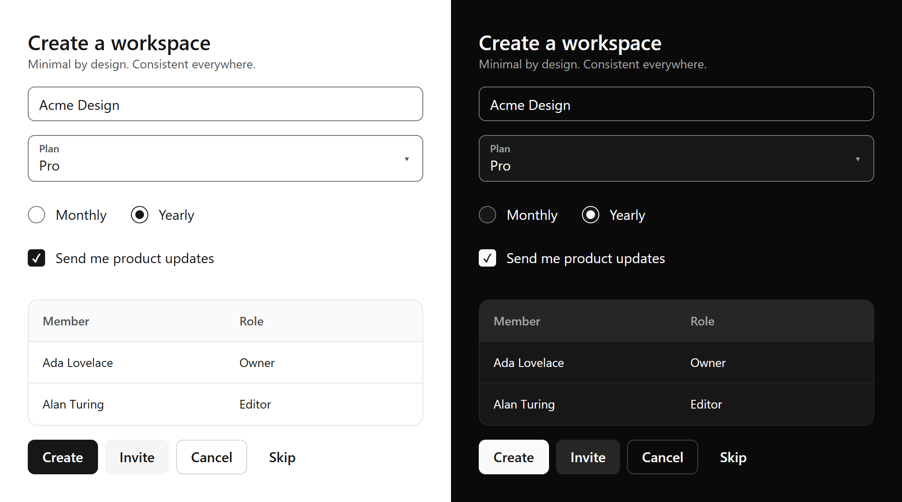

# Dazo UI

**Minimal by design. Consistent everywhere.**

[](https://www.npmjs.com/package/dazo-ui)
[](https://github.com/ahmedgourmat/dazo-ui/blob/main/LICENSE)
[](https://github.com/ahmedgourmat/dazo-ui/actions/workflows/ci.yml)

A small, theme-aware component library for **React Native and the web**. One API covers iOS, Android and browsers, with light and dark themes, design tokens and accessibility built in.



- **One API on every platform.** The same components and props on iOS, Android and the web (through react-native-web).
- **A real design system.** Semantic color roles, a type scale, a 4px spacing scale, and sizes, radius, elevation and motion tokens.
- **Light, dark and system themes** from the start, with optional accent colors and overrides for any token.
- **Accessible by default.** Roles and states for screen readers, a keyboard focus ring on web, 44-point touch targets on iOS and Android, and WCAG AA contrast checked in tests.
- **Small.** About 11 kB minified and brotlied for the whole library, and 2.5–3.5 kB for a single component. Each component can be imported on its own, and there are no runtime dependencies.
- **Typed.** Written in TypeScript, with types for every prop and token.

## Contents

- [Requirements](#requirements)
- [Installation](#installation)
- [Quick start](#quick-start)
- [Components](#components)
- [Theming](#theming)
- [Design system](#design-system)
- [Accessibility](#accessibility)
- [Refs](#refs)
- [TypeScript](#typescript)
- [Upgrading from 1.x](#upgrading-from-1x)
- [Contributing](#contributing)
- [License](#license)

## Requirements

| Package | Version | Needed for |
|---|---|---|
| react | 19 or later | All platforms |
| react-native | 0.81.5 or later (Expo SDK 54+) | All platforms. Web apps alias it to react-native-web, but its type definitions are still used |
| react-native-web | 0.19 or later | Web only |

## Installation

### Expo / React Native

```bash
npx expo install dazo-ui
```

If your Expo app also runs on the web:

```bash
npx expo install react-dom react-native-web @expo/metro-runtime
```

FileInput needs a file picker on iOS and Android. dazo-ui doesn't install one, but it ships an adapter for `expo-document-picker`:

```bash
npx expo install expo-document-picker
```

```tsx
import * as DocumentPicker from 'expo-document-picker'
import { expoDocumentPicker, FileInput } from 'dazo-ui'

<FileInput multiple accept="image/*,application/pdf" customPicker={expoDocumentPicker(DocumentPicker)} />
```

Any other picker works too: `customPicker` receives `{ accept, multiple }` and resolves with the picked files, or `null` when cancelled.

### Web (Vite)

```bash
npm install dazo-ui react-native-web
```

Alias `react-native` to `react-native-web` and let the bundler prefer `.web` files:

```ts
// vite.config.ts
import { defineConfig } from 'vite'
import react from '@vitejs/plugin-react'

export default defineConfig({
  plugins: [react()],
  resolve: {
    alias: { 'react-native': 'react-native-web' },
    extensions: ['.web.tsx', '.web.ts', '.tsx', '.ts', '.jsx', '.js'],
  },
})
```

### Web (Next.js)

```bash
npm install dazo-ui react-native-web
```

```ts
// next.config.ts
import type { NextConfig } from 'next'

const nextConfig: NextConfig = {
  transpilePackages: ['dazo-ui'],
  webpack: (config) => {
    config.resolve.alias = { ...(config.resolve.alias || {}), 'react-native$': 'react-native-web' }
    config.resolve.extensions = ['.web.js', '.web.jsx', '.web.ts', '.web.tsx', ...config.resolve.extensions]
    return config
  },
  turbopack: {
    resolveAlias: { 'react-native': 'react-native-web' },
    resolveExtensions: ['.web.js', '.web.jsx', '.web.ts', '.web.tsx', '.mjs', '.ts', '.tsx', '.js', '.jsx', '.json'],
  },
}

export default nextConfig
```

## Quick start

Wrap your app once in `ThemeProvider`, then use the components:

```tsx
import { Button, Container, Text, ThemeProvider } from 'dazo-ui'

export default function App() {
  return (
    <ThemeProvider colorScheme="system">
      <Container padding="lg" gap="sm" borderWidth="thin" borderColor="border" borderRadius="lg">
        <Text variant="title">Welcome</Text>
        <Text color="foregroundMuted">Build once and ship on native and web.</Text>
        <Button label="Get started" onPress={() => {}} />
      </Container>
    </ThemeProvider>
  )
}
```

## Components

Every component also accepts the [style props](#style-props) (`padding`, `margin`, `width`, `backgroundColor`, `borderRadius`, `shadow`, …) and a [`ref`](#refs).

### Button

```tsx
<Button label="Save" onPress={save} />
<Button label="Invite" variant="secondary" />
<Button label="Cancel" variant="outline" />
<Button label="Skip" variant="ghost" />
<Button label="Saving" loading />
<Button label="Continue" size="lg" fullWidth rightIcon={<ArrowRight size={16} />} />
```

- `variant`: `solid` (default) · `secondary` · `outline` · `ghost`
- `size`: `sm` 32 · `md` 40 (default) · `lg` 48 · `xl` 56
- Also: `disabled`, `loading`, `fullWidth`, `leftIcon`, `rightIcon`, `labelStyle`

### Input

```tsx
const [email, setEmail] = useState('')

<Input value={email} onChangeText={setEmail} placeholder="Email" keyboardType="email-address" />
<Input placeholder="Password" secureTextEntry invalid={tooShort} />
```

- `variant`: `outline` (default) · `solid` · `ghost`
- `size`: `sm` · `md` (default) · `lg` · `xl`
- `invalid` draws a danger edge and sets `aria-invalid`.
- Also: `leftIcon`, `rightIcon`, `inputStyle`. Every React Native `TextInput` prop works too.

### Select

```tsx
<Select
  label="Plan"
  value={plan}
  onChange={setPlan}
  options={[
    { label: 'Starter', value: 'starter' },
    { label: 'Pro', value: 'pro' },
    { label: 'Legacy', value: 'legacy', disabled: true },
  ]}
/>
```

Opens a menu of options. Also takes `placeholder`, `size`, `disabled`, `leftIcon` and `rightIcon` (which replaces the chevron).

### Checkbox and RadioGroup

```tsx
<Checkbox label="Send me product updates" checked={updates} onChange={setUpdates} />

<RadioGroup
  accessibilityLabel="Billing"
  direction="row"
  value={billing}
  onChange={setBilling}
  options={[
    { label: 'Monthly', value: 'monthly' },
    { label: 'Yearly', value: 'yearly' },
  ]}
/>
```

### FileInput

```tsx
<FileInput label="Attachment" accept="image/*,.pdf" multiple onFilesSelected={(files) => upload(files)} />
```

On the web it opens the browser's file picker, and each file comes with its `File` object. On iOS and Android, pass a `customPicker` (see [Installation](#expo--react-native)). Pass `value` to control the text shown in the field.

### Table

```tsx
<Table
  columns={[
    { key: 'name', title: 'Member' },
    { key: 'role', title: 'Role', width: 120 },
    { key: 'seats', title: 'Seats', align: 'right', render: (value) => <Text>{String(value)}</Text> },
  ]}
  data={members}
  keyExtractor={(row) => row.id}
/>
```

Also takes `striped`, `stripedColumn`, `horizontalScroll` (on by default) and `emptyText`.

### Text

```tsx
<Text variant="title">Settings</Text>
<Text size="sm" color="foregroundMuted">Last saved 2 minutes ago</Text>
<Text lines={2}>A long description that stops after two lines…</Text>
```

- `variant`: `default` · `title` · `subtitle` · `caption`
- `size`: any step of the [type scale](#typography), which also sets its line height
- `color`: a theme color name or any color
- `lines` limits the number of lines; `letters` cuts the text after that many characters.

### Textarea

```tsx
<Textarea value={bio} onChangeText={setBio} placeholder="Tell us about yourself" rows={3} maxRows={8} maxLength={280} showCount />
```

A multiline Input with the same `variant`, `size` and `invalid` props. It shows `rows` lines, grows with its text up to `maxRows`, then scrolls. `showCount` shows "120 / 280" under the text, linked to the field for screen readers. Without `value` it keeps its own text (`defaultValue`).

### Switch

```tsx
<Switch label="Push notifications" checked={enabled} onChange={setEnabled} />
<Switch label="Dark mode" defaultChecked size="sm" labelPosition="end" />
```

- Controlled with `checked` and `onChange`, or uncontrolled with `defaultChecked`.
- `labelPosition`: `start` (label first, switch at the far end, as in a settings row; the default) · `end`
- `size`: `sm` · `md`
- Use `accessibilityLabel` when there is no visible label.

### Badge

```tsx
<Badge>New</Badge>
<Badge tone="success">Paid</Badge>
<Badge tone="warning" variant="subtle">Pending</Badge>
```

- `tone`: `neutral` · `danger` · `success` · `warning` · `info`
- `variant`: `solid` (filled with the tone) · `subtle` · `outline` (both neutral, with a dot in the tone's color)
- `size`: `sm` · `md`; `icon` replaces the dot.

### Avatar

```tsx
<Avatar name="Ada Lovelace" src={user.photoUrl} />
<Avatar name="Alan Turing" size="lg" shape="rounded" />
```

Shows the image, or the person's initials ("Ada Lovelace" → AL) when there is no image or it fails to load. `size`: `xs` 24 · `sm` 32 · `md` 40 · `lg` 48 · `xl` 64. `shape`: `circle` · `rounded`. The `name` is what screen readers read; without one the avatar is decorative.

### Progress and Spinner

```tsx
<Progress value={3} max={5} label="Step 3 of 5" />
<Progress label="Syncing" />   {/* no value: unknown progress */}
<Spinner label="Loading messages" />
```

- Progress takes `tone` and `size` (`sm` 4 · `md` 8). Without a `value`, the bar sweeps back and forth; it stands still when the user asks for less motion.
- Spinner takes `size` (`sm` · `md` · `lg`) and `color` (a theme color name or any color).
- Both are announced as progress indicators with their `label`.

### Divider

```tsx
<Divider />
<Divider label="or" />
<Divider orientation="vertical" />   {/* inside a row */}
```

A 1px line in the `border` color, announced as a separator. Use `decorative` to hide it from screen readers.

### Container

A `View` that takes the style props. Add `scrollable` to make it a `ScrollView`.

```tsx
<Container flexDirection="row" gap="sm" padding="md" backgroundColor="surfaceMuted" borderRadius="md">
  …
</Container>
```

### Style props

Every component accepts these and resolves theme tokens:

- **Spacing:** `padding`, `margin`, `gap` and their sides take `xs` 4 · `sm` 8 · `md` 16 · `lg` 24 · `xl` 32 · `xxl` 48, or a number.
- **Colors:** `backgroundColor`, `borderColor`, … take a [color role](#colors) (`"surfaceMuted"`) or any color.
- **Borders:** `borderRadius` takes `none` · `xs` · `sm` · `md` · `lg` · `xl` · `2xl` · `3xl` · `full`. `borderWidth` takes `thin` · `medium`.
- **Elevation:** `shadow` takes `sm` · `md` · `lg` · `xl`.
- **Layout and size:** flex, position and size props, `opacity` and `transform` are passed through.

## Theming

```tsx
<ThemeProvider
  colorScheme="system" // 'light' | 'dark' | 'system'
  accent="blue" // 'neutral' (default) | 'blue' | 'green' | 'violet' | 'orange' | your own shades
  theme={{ colors: { primary: '#0F766E' }, radius: { md: 6 } }} // override any token
>
  <App />
</ThemeProvider>
```

| Prop | Default | Description |
|---|---|---|
| `colorScheme` | `"system"` | Use the light or dark theme, or follow the device setting. |
| `accent` | `"neutral"` | Color of primary actions, selected states and focus rings. Surfaces and text stay neutral. Your own shades: `{ 50, 200, 400, 600, 700 }`; light mode uses 700 (600 for the ring), dark mode uses 400. |
| `theme` | | Overrides any part of the theme. Values you don't override are kept. |

Read the current theme with `useTheme()`:

```tsx
const { colors, space, radius } = useTheme()
```

`lightTheme`, `darkTheme`, `palette` (the neutral grays) and `accentPalettes` are exported too.

**Custom fonts:** set `theme={{ fontFamily: { regular, medium, semibold, bold } }}`. On the web the default font stack is `Inter, ui-sans-serif, system-ui, …, sans-serif`, which uses Inter when your app loads it and the system font otherwise. iOS and Android use the system font.

## Design system

The default theme is monochrome: white and near-white surfaces in light mode, near-black and charcoal in dark mode, neutral grays for text and borders, and color only where it means something. Components read **semantic roles**, never raw palette values, so changing a role changes it everywhere.

### Colors

| Role | Light | Dark | Used for |
|---|---|---|---|
| `background` | `#FFFFFF` | `#0A0A0A` | App background |
| `foreground` | `#171717` | `#FAFAFA` | Main text and icons |
| `surface` | `#FFFFFF` | `#171717` | Component surfaces |
| `surfaceMuted` | `#FAFAFA` | `#262626` | Table headers, stripes |
| `surfaceElevated` | `#FFFFFF` | `#262626` | Menus and popovers |
| `surfaceInverse` | `#171717` | `#FAFAFA` | Inverted surfaces |
| `foregroundMuted` | `#525252` | `#A3A3A3` | Labels, placeholders, captions |
| `foregroundSubtle` | `#737373` | `#737373` | Low-emphasis content |
| `border` | `#E5E5E5` | `#262626` | Dividers and containers |
| `borderStrong` | `#D4D4D4` | `#404040` | Emphasized borders |
| `input` | `#737373` | `#737373` | Edges of inputs, checkboxes and radios |
| `ring` | `#171717` | `#A3A3A3` | Keyboard focus ring |
| `primary` / `primaryForeground` | `#171717` / `#FFFFFF` | `#FAFAFA` / `#171717` | Main actions |
| `secondary` / `secondaryForeground` | `#F5F5F5` / `#171717` | `#262626` / `#FAFAFA` | Secondary actions |
| `danger` · `success` · `warning` · `info` | red · green · amber · blue 600 | the same, 400 | Status |
| `dangerForeground` … `infoForeground` | white · `#0A0A0A` · `#0A0A0A` · white | `#0A0A0A` | Text on a status color |

The contrast of every text, focus-ring and field-edge pair is tested against WCAG 2.2 AA, in both modes and with every accent. `success` and `warning` reach only about 3.2:1 on white: enough for icons and borders, but not for small text. Put text on a status color with its `…Foreground` role, as solid Badges do.

### Typography

| Size | `xs` | `sm` | `base` | `lg` | `xl` | `2xl` | `3xl` | `4xl` | `5xl` |
|---|---|---|---|---|---|---|---|---|---|
| Font size | 12 | 14 | 16 | 18 | 20 | 24 | 30 | 36 | 48 |
| Line height | 16 | 20 | 24 | 28 | 28 | 32 | 36 | 40 | 53 |

Weights: `regular` 400 · `medium` 500 · `semibold` 600 · `bold` 700.

### Spacing, radius and sizes

- **Spacing:** the full 4px scale (with 2px half steps) is `useTheme().space`, so `space[1.5]` is 6 and `space[3]` is 12. Spacing props use the named steps listed under [Style props](#style-props).
- **Radius:** `none` 0 · `xs` 2 · `sm` 4 · `md` 8 (inputs, buttons) · `lg` 12 (cards, menus) · `xl` 16 · `2xl` 20 · `3xl` 24 · `full`.
- **Controls:** `sm` 32 · `md` 40 · `lg` 48 · `xl` 56. On iOS and Android, controls shorter than 44 get a 44-point touch area.
- **Icons:** `xs` 12 · `sm` 16 · `md` 20 · `lg` 24 · `xl` 32 (`useTheme().iconSize`).

### Elevation and motion

- **Elevation:** `shadow="sm" | "md" | "lg" | "xl"` draws shadows on iOS, `elevation` on Android and `box-shadow` on the web. Prefer borders and surface colors, and keep shadows for things that float, such as menus.
- **Motion:** `useTheme().motion` has durations (`fast` 100ms, `normal` 180ms, `slow` 250ms, `slower` 350ms) and easing curves. `useReducedMotion()` is true when the user has asked the system for less motion; components skip their animations then.

### Interaction states

| State | Behavior |
|---|---|
| Hover | Web only: buttons, fields and menu options change their surface. Touch screens never show hover. |
| Focus | Web: a 2px `ring` outline when focus comes from the keyboard; text fields show it whenever they have focus. iOS and Android use their own focus indicators. |
| Pressed | Slightly lower opacity. |
| Disabled | The same look at 50% opacity. |
| Selected | Uses `primary`; the selected Select option also gets a checkmark, so color isn't the only signal. |
| Invalid | `<Input invalid />` draws a `danger` edge and sets `aria-invalid`. |

## Accessibility

- Every control has the right role and state (`button`, `checkbox`, `radio`, `radiogroup`, checked, disabled, busy, expanded) on iOS, Android and the web.
- **Web keyboard:** Tab reaches every control, Enter and Space activate them, and Escape closes the Select menu. A visible focus ring appears for keyboard users.
- **Touch targets** are at least 44 points on iOS and Android.
- **Contrast** of text, focus rings and field edges meets WCAG 2.2 AA, checked in the tests.
- **Motion:** the system's reduce-motion setting is respected.
- **Tested:** automated accessibility checks (axe-core) run on every component in CI.

Give icon-only or unlabeled controls a name, e.g. `<RadioGroup accessibilityLabel="Billing" />` or `<Checkbox value="terms" />`.

## Refs

Every component takes a `ref`, which React 19 passes as a normal prop:

| Component | `ref.current` is |
|---|---|
| Input, Textarea | the `TextInput`, so you can `focus()` it |
| Button, Checkbox, Switch, Select, FileInput | the pressable control |
| Container | the `View`, or the `ScrollView` when `scrollable` |
| Text | the `Text` |
| RadioGroup, Table, Avatar, Badge, Divider, Progress, Spinner | the outer `View` |

```tsx
const password = useRef<TextInput>(null)

<Input placeholder="Email" onSubmitEditing={() => password.current?.focus()} />
<Input ref={password} placeholder="Password" secureTextEntry />
```

## TypeScript

Every component's props are typed, and these types are exported: every component's props (`ButtonProps`, `SwitchProps`, …), `Tone`, `Theme`, `ThemeColors`, `ThemeMode`, `ThemeAccent`, `AccentName`, `AccentPalette`, `ControlSize`, `FontSizeKey`, `ShadowKey`, `SpaceStep`, `PickedFile`, `FilePicker`, `FilePickerOptions` and `ExpoDocumentPickerModule`.

## Upgrading from 1.x

2.0.0 removes the `Icon` component, changes the default look (a near-black primary color instead of purple, rounder corners, 16px body text) and publishes only the built package. Old color and font-size names (`textPrimary`, `backgroundSurface`, `fontSize.md`, …) still work but are deprecated. See the [changelog](https://github.com/ahmedgourmat/dazo-ui/blob/main/src/CHANGELOG.md) for the full list and a migration guide.

## Contributing

Issues and pull requests are welcome. This repository is a pnpm workspace managed with Turbo:

| Folder | Contents |
|---|---|
| `src` | The `dazo-ui` package |
| `apps/web` | Vite showcase |
| `apps/mobile` | Expo showcase |
| `apps/storybook` | Storybook |

```bash
pnpm install
pnpm dev                          # every app in watch mode
pnpm --filter web dev             # one app: web, mobile or storybook
pnpm --filter dazo-ui test        # library tests (web and native builds)
pnpm turbo run typecheck lint test build check:package size   # what CI runs
```

CI also bundles the Expo app for Android and checks the package with publint, arethetypeswrong and size limits.

## License

[MIT](https://github.com/ahmedgourmat/dazo-ui/blob/main/LICENSE) © ahmedgourmat
